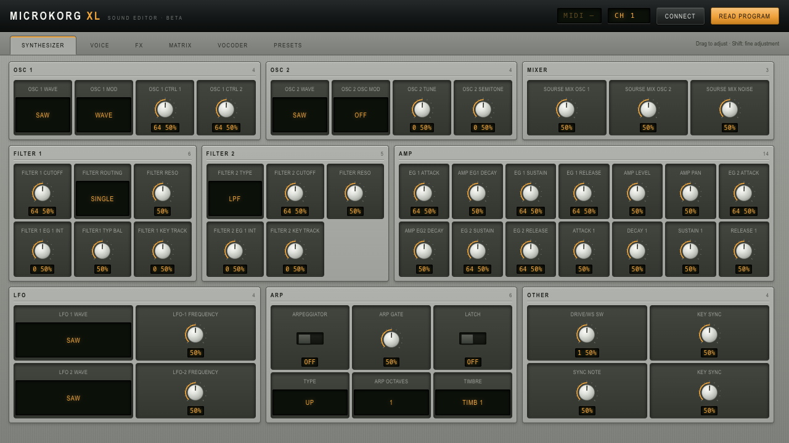

# microKORG XL Web Editor — Beta

A compact, browser-based sound editor for the **Korg microKORG XL**, built with plain HTML, CSS and JavaScript. Connect your synth through Web MIDI to adjust parameters and browse local preset banks.

**Status: beta.** MIDI mappings and program decoding are experimental and need further testing on hardware. Back up your sounds before experimenting. This is an independent project, unaffiliated with Korg.



## Features

- Compact synthesizer dashboard designed to fit a 1280 × 720 viewport at 100% browser zoom.
- Dedicated Synthesizer, Matrix, Vocoder and Presets tabs.
- Knobs, expanded selectors and ON/OFF switches for the arpeggiator, latch and vocoder.
- Six modulation patches and a 16-band vocoder level/pan view.
- MIDI CC/NRPN parameter messages and a SysEx program-read request.
- Local `.mkxl_all` bank loading, preset search and SysEx sending.
- In-memory control values and preset search retained when switching tabs.
- No build step, runtime dependencies, account or remote backend.

## Requirements

- A microKORG XL connected to your computer by USB MIDI or a suitable MIDI interface.
- A browser that supports Web MIDI with SysEx access. Chrome is the recommended starting point.
- Python 3 for the local server below, or any static HTTP server.

Web MIDI requires a secure browser context and permission to access MIDI devices. Use localhost for local development, or HTTPS if hosting elsewhere. See [MDN's Web MIDI access documentation](https://developer.mozilla.org/en-US/docs/Web/API/Navigator/requestMIDIAccess).

## Use online

[**Open the editor in your browser**](https://soyotrokevin.github.io/microkorg-xl-web-editor/)

Use Chrome, connect your synth, and grant MIDI/SysEx permission when clicking **Connect**. No installation or local server is needed for the hosted version. This remains a beta; the hardware and mapping limitations below still apply.

The **Presets** tab has a shared-bank selector when banks are available. Choose a bank and click **Load bank**, then **Send** next to a program. Loading a bank only downloads its data; it does not send anything to your synth until you click **Send**. You can still load a local `.mkxl_all` file.

## Quick start (local)

1. Download this repository with **Code → Download ZIP** and extract it, or clone it:

   ```sh
   git clone https://github.com/soyotrokevin/microkorg-xl-web-editor.git
   cd microkorg-xl-web-editor
   ```

2. In a terminal opened in the project folder, start a local server:

   ```sh
   python3 -m http.server 8781 --bind 127.0.0.1
   ```

   On Windows, `py -m http.server 8781 --bind 127.0.0.1` may be used instead.

3. Open [http://localhost:8781/mkxl_editor.html](http://localhost:8781/mkxl_editor.html) in Chrome.
4. Connect and power on your synth. Click **Connect** and allow MIDI access, including SysEx.
5. Set **CH** to the synth's MIDI channel (1–16).
6. Click **Read program** to request the current sound before editing. Until a successful read, controls show placeholder values.

Stop the local server with **Ctrl+C** when finished.

## Editing sounds

- Drag a knob upward or downward to adjust it; hold **Shift** for finer control.
- Double-click a knob to reset it to MIDI value 64. This is a midpoint reset, not the original patch value.
- Focus a knob and use the arrow keys to change its value; **Shift** reduces the step. **Home** and **End** select MIDI values 0 and 127.
- Click a selector to choose an option, or click an ON/OFF switch to toggle it.
- Switch tabs for modulation routing, vocoder bands or preset banks. Use Left/Right arrows while a tab is focused to move between tabs.
- Changes are sent immediately when MIDI is connected. Use the synth's **WRITE** operation to save a sound permanently.

## Loading a preset bank

1. Open **Presets**.
2. Drop your own `.mkxl_all` file onto the drop area, or click the area to choose a file.
3. Search by preset name or exact program number.
4. On the synth, enable SysEx reception (`MIDI FLT → SYS EX = ENABLE`). If required for the intended operation, disable write protection (`GLOBAL → PROTECT = OFF`).
5. Click **Send** next to a preset to send its program data to the synth's edit buffer.
6. Audition the result and use **WRITE** on the synth if you want to keep it.

Preset files are read locally in your browser. The shared catalog includes the microKORG XL Factory Presets bank (`MKXL_FactoryPreset.mkxl_all`). The other banks are not included.

## Beta limitations

- Not every parameter, CC/NRPN mapping or packed SysEx field has been verified on hardware. Reading a program may not reproduce every setting accurately.
- Some discrete parameters, including modulation destinations, currently appear as numeric knobs rather than named choices.
- MIDI ports are selected automatically: an output containing `sound` and an input containing `kbd` or `knob` are preferred; otherwise the first available ports are used. There is no manual port selector yet. Disconnect unrelated MIDI devices if the wrong ports are selected.
- Changing controls without a MIDI connection updates the local interface only. Those changes are not replayed automatically after connecting.
- Control state is held in memory and is lost on reload. There is no edited-bank export, local persistence or undo history.
- Smaller windows use scrolling. Compatibility with microKORG XL+, the original microKORG and other models is not established.
- The interface and simulated MIDI messages have been checked in desktop Chrome; complete hardware validation remains pending.

## Troubleshooting

- **Web MIDI unavailable:** use a compatible browser and open the localhost address above.
- **No MIDI outputs found:** check the USB/interface connection and any required OS MIDI drivers, then reload and reconnect.
- **MIDI permission denied:** allow MIDI/SysEx in the browser's site settings and reconnect.
- **Read program does nothing:** verify the MIDI channel, SysEx reception and automatically selected MIDI ports.
- **Controls do not match the synth:** read the program again; if a mismatch remains, report it as a beta mapping issue.

## Project structure

```text
mkxl_editor.html              Standalone application
README.md                     Setup, usage and beta notes
docs/images/editor-beta.png   Screenshot of the English beta UI
```

To report a bug, open an issue with your OS, browser version, synth model, connection type, parameter and steps to reproduce. Do not include private preset banks unless you intend to share them publicly.

## Publishing shared banks

Add banks you are allowed to redistribute to `presets/`, then list them in `presets/banks.json`:

```json
[
  { "name": "My sound bank", "file": "presets/my-sound-bank.mkxl_all" }
]
```

Bank paths must point inside this site's `presets/` directory. Everything added to this public repository is publicly downloadable. Local files selected in the editor are never uploaded.

GitHub Pages serves the root of the `main` branch. Updates pushed to `main` are published automatically.
