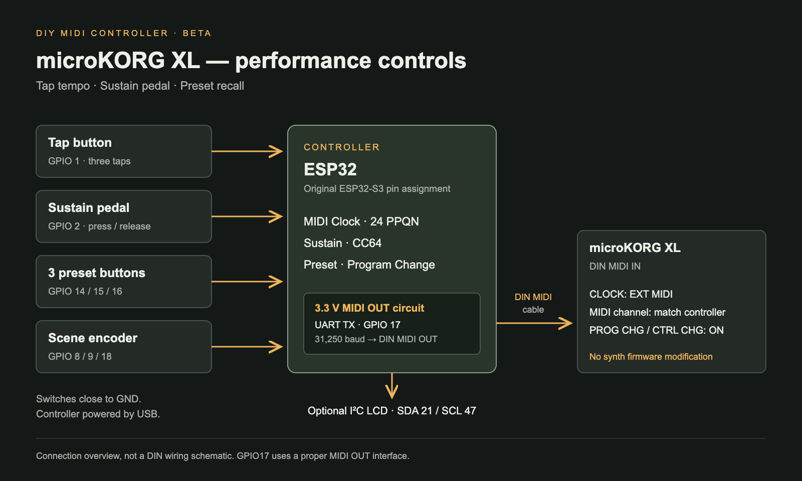

# microKORG XL companion MIDI controller — beta

A standalone MIDI controller extracted from Samplera_v06, focused on three performance controls for the **microKORG XL**:

- **Tap tempo:** three taps activate a MIDI Clock stream (24 pulses per quarter note). Further taps update the tempo using the most recent interval. Supported range: 30–240 BPM.
- **Sustain pedal:** pedal down sends CC64 = 127; release sends CC64 = 0.
- **Preset buttons:** three buttons recall the programs assigned to the active scene, using bank select and Program Change.

Turn the encoder to browse scenes and press it to activate a scene. Confirming a different scene stops the outgoing clock and resets the tap sequence. It does not select a preset automatically. A 16×2 I²C LCD shows the selected scene, preset or tempo; the controller still runs if no LCD is detected.

## Connection

Connect the controller's **DIN MIDI OUT** to the microKORG XL's **DIN MIDI IN**. The ESP32's GPIO17 UART output must go through a suitable **3.3 V MIDI OUT interface circuit**; the diagram is a connection overview, not a bare-pin DIN wiring schematic. Power the controller through its board's normal USB power input.

Buttons and a normally-open sustain pedal connect between their input GPIO and GND, with the internal pull-ups enabled. If your pedal has the opposite polarity, change `SUSTAIN_ACTIVE_LEVEL`. Use LCD hardware and pull-ups compatible with the ESP32's 3.3 V GPIO levels.

| Connection | GPIO / configuration |
|---|---|
| MIDI TX → MIDI OUT circuit | 17; UART 31,250 baud, 8N1 |
| Tap button | 1 |
| Sustain pedal | 2 |
| Preset buttons | 14 / 15 / 16 |
| Encoder A / B / switch | 8 / 9 / 18 |
| Optional LCD SDA / SCL | 21 / 47 |
| MIDI channel | 1 by default; configurable from 1 to 16 |

The GPIO assignment is inherited from the original ESP32-S3 project. Confirm that it matches your exact board before uploading.

## microKORG XL settings

- Match the synth's global MIDI channel to `MIDI_CHANNEL` in the sketch.
- Set `MIDI → CLOCK` to `EXT MIDI` for clock received through the DIN input (`AUTO` is also available).
- Enable `MIDI FLT → PROG CHG` and `CTRL CHG` so the synth receives preset and pedal messages.
- Play the synth normally; the controller supplies tempo and control messages, not notes. It does not send MIDI Start/Stop messages.

Reference: [Korg microKORG XL owner's manual](https://cdn.korg.com/us/support/download/files/9992be0e2327da2fcc3b4183153868f7.pdf).

## Code and configuration

Open [`Microkorg_XL_Controller/Microkorg_XL_Controller.ino`](Microkorg_XL_Controller/Microkorg_XL_Controller.ino) in Arduino IDE with the Arduino-ESP32 board package and select your actual board. Only the core `Arduino` and `Wire` libraries are used.

Edit the `scenes[]` array to assign up to three programs per scene. `program('A', 2, 4)` represents **A24**. A11–A88 map to MIDI values 0–63; B11–B88 map to 64–127. Use `-1` for an unassigned button.

The original physical button order is retained: GPIO14 selects entry 1, GPIO15 selects entry 3 and GPIO16 selects entry 2. Set `PRESET_ENTRY` to `{0, 1, 2}` if your buttons are wired sequentially. The included scenes are generic examples, not the original performance set list.

## Validation

A host C++ build with mocked Arduino interfaces verified program-number conversion, outgoing MIDI bytes, three-tap activation, scene-change clock reset, sustain debounce and the original preset-button order. This is not an ESP32 firmware build or a hardware test. MIDI Clock is serviced by the main loop, as in v06; timing stability needs validation on the actual hardware.

The original `Samplera_v06.ino` was left unchanged.

## Short description for Reddit

I also made a small ESP32-based MIDI controller for the microKORG XL. It adds tap tempo via MIDI Clock, a sustain pedal input, and three preset-recall buttons. An encoder lets me organize those presets into scenes for live use. It connects to the synth's MIDI IN and works independently of the browser editor—there's no firmware modification to the microKORG itself.
